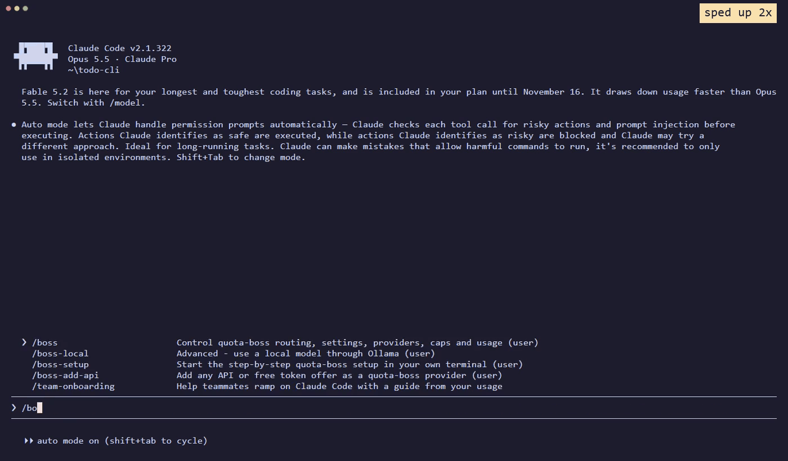

<div align="center">

# Quota Boss

**A multi-model orchestrator for your coding agent: a boss that hands each sub-task to the cheapest model that can
do it,<br>across the subscriptions you already pay for and the free AI offers you choose.**

[](https://www.npmjs.com/package/quota-boss)
[](https://github.com/CrazyToto/quota-boss/actions/workflows/ci.yml)
[](#install)
[](package.json)
[](package.json)
[](LICENSE)

[Install](#install) · [Quick start](#quick-start) · [Commands](#commands) · [How it works](#how-it-works) · [Documentation](#documentation)



</div>

Quota Boss is a harness around **Claude Code** or **Codex**: it adds the rules, the workers and the live quota numbers
that turn your agent into an orchestrator. Your best model plans, decides and checks the results. Everything else goes
to a cheaper model on one of your subscriptions (**Claude**, **ChatGPT / Codex**, **GitHub Copilot**, **Grok**,
**Google Antigravity / Gemini**), to **Perplexity** for research, or to a free offer or local model you have switched
on.

- **It picks the model for each job.** Every pick weighs how important the task is, how good each model is at that
  kind of work, and how much quota you have left.
- **It knows your limits live.** The 5-hour and weekly limits of Claude and Codex are on screen with every prompt, and
  a subscription that is running low gets less work.
- **It uses only the providers' official programs, signed in as you.** It never reads your keys or tokens, shares
  accounts or automates websites.

## Install

You need [Node.js](https://nodejs.org) 18 or newer and [Claude Code](https://code.claude.com) with a Claude plan.
The [Codex CLI](https://github.com/openai/codex) with a ChatGPT plan is recommended, because most delegated work goes
there. Everything else is optional and offered during setup.

```bash
npx quota-boss@latest
```

This works the same on Windows, macOS and Linux. To see first what would change, add `--dry-run`. The installer backs
up your Claude Code settings, keeps your existing status line, and `npx quota-boss@latest --uninstall` removes
everything again. Run the first command again to update.

<details>
<summary>Other ways to install</summary>

- **Keep the short `quota-boss` command:** `npm install -g quota-boss`, then `quota-boss`.
- **From source:** `git clone https://github.com/CrazyToto/quota-boss && cd quota-boss && node install.js`. The same
  flags work: `node install.js --dry-run` and `node install.js --uninstall`.

</details>

## Quick start

1. **Set it up.** Type `/boss-setup` in Claude Code. It gives you one command that walks you through your
   subscriptions and the free offers in your own terminal. Nothing changes until you confirm the summary at the end.
2. **Turn it on in a project.** Type `/boss on`. Projects without it stay untouched.
3. **Work as usual.** The boss splits your task, hands out the parts, checks the results and tells you which model
   did what.

The step-by-step guide is in [docs/GETTING-STARTED.md](docs/GETTING-STARTED.md). If something looks wrong, run
`quota-boss doctor`: it lists each problem with its fix and spends no quota.

## Commands

Inside Claude Code:

| Command | What it does |
|---|---|
| `/boss-setup` | Start the step-by-step setup |
| `/boss on [quality\|balanced\|frugal]` | Turn boss mode on for this project, with a profile |
| `/boss off` | Turn it off |
| `/boss status` | Show limits, mode, profile and workers |
| `/boss settings` | Show every setting with its current value and the command that changes it |
| `/boss route` | Show which model gets which kind of work right now |
| `/boss-add-api` | Add any API or free offer as a provider |
| `/boss-local` | Use a local model through Ollama |
| `/handoff` | Save notes so a fresh session continues where this one stopped |
| `/boss help` | List all commands |

In your terminal:

| Command | What it does |
|---|---|
| `quota-boss doctor` | Check the installation and list each problem with its fix |
| `quota-boss savings` | Show how your work was spread across models and what that saved |
| `quota-boss route --explain` | Show every candidate model with its numbers and why it won or lost |
| `quota-boss use <provider\|model> on\|off` | Choose which subscriptions and models may get work |
| `quota-boss settings` | Show all settings; `quota-boss explain <setting>` explains one |

The short `quota-boss` form needs `npm install -g quota-boss`. Without it, use `npx quota-boss <command>` or
`node ~/.claude/quota-boss/scripts/quota-boss.js <command>`. All settings are explained in
[docs/SETTINGS.md](docs/SETTINGS.md).

## How it works

```
You ─► Claude Code (Opus = boss: plan, classify, delegate, verify)
        │  every prompt: "Claude 5h 41% wk 49% | Codex 5h 3% wk 12% | profile balanced | mode normal"
        ├─► codex-worker  ─► Codex (GPT-6.1-Sol, effort medium) ─► implements, runs tests, 10-line report
        ├─► gpt-advisor   ─► Codex read-only ─► independent second opinion
        ├─► sonnet-worker ─► Sonnet, larger implementation
        ├─► haiku-worker  ─► Haiku, small edits, tests, docs
        ├─► scout         ─► Haiku, code search
        ├─► reviewer      ─► Sonnet, reviews diffs
        ├─► cli-worker    ─► another official CLI: Copilot, Grok, Antigravity (Gemini), OpenCode
        ├─► self-worker   ─► the boss model in a separate context for large or parallel jobs
        └─► researcher    ─► web search, or a ready-made prompt for Perplexity
```

For every sub-task the boss sets a **tier** (critical, normal or trivial) and a **category** (architecture, debugging,
implementation, review, research or mechanical). Quota Boss then scores every model you have:

```
utility = P(success) ^ alpha(tier, profile)  /  ( cost × quota price )
```

- **P(success)** starts from a quality score per model and category, and is updated from the results the boss
  verifies. Failures count double.
- **Quota price** rises when a subscription would run dry before its reset, and falls when plenty of quota is about
  to reset unused.
- **Alpha** sets how much quality matters. For critical work quality wins; for trivial work the cheapest adequate
  model wins. The profile (`quality`, `balanced` or `frugal`) shifts it.
- **When a result fails its check**, the same model gets more reasoning effort first, then the next better model.
- **Small jobs stay with the boss**, because handing over a few minutes of work costs more than it saves.

The full algorithm is in [docs/ROUTING.md](docs/ROUTING.md). Model scores, prices and their sources are in
[docs/MODELS.md](docs/MODELS.md).

## Does it pay off?

Quota Boss hands down the work your expensive model does not need to do, and keeps the work where handing it over
would cost more than it saves. The numbers so far:

| Measurement | Result |
|---|---|
| Real work in this repository over 7 days (`quota-boss savings`) | Workers did 19% of the work. Had the Opus boss done all of it, the estimate is **35% more cost**. |
| Benchmark, one medium task handed to Codex (earlier rule version) | **35% less Claude usage** than without boss mode, with the same hidden test results. |
| Benchmark, small jobs in a fresh session (today's rules) | The boss keeps the work. Overhead: 3% with Opus as the boss, 12% with GPT-6.1 Sol, same results. |

The bigger the job and the longer the session, the more there is to hand down. The benchmark is small: one run per
row, in short sessions. All numbers and the method are in [docs/BENCHMARKS.md](docs/BENCHMARKS.md), the harness is in
[bench/](bench/README.md), and `quota-boss savings` shows the numbers for your own work.

## Providers and free offers

| Kind | Examples | How it is used |
|---|---|---|
| Subscriptions | Claude, ChatGPT / Codex, GitHub Copilot, Grok, Google Antigravity (Gemini) | Through each provider's official CLI, signed in as you |
| Research | Perplexity Pro | The boss writes the prompt and copies it to your clipboard; you paste the answer back with `/pplx-result` |
| Free API offers | Mistral, OpenCode Zen, OpenRouter, Cloudflare, Cohere, Gemini, NVIDIA, Z.ai, Kilo | Off until you choose them; each shows its limit and data warning first |
| Local models | Ollama | `/boss-local` |
| Anything else | Any API with a key | `/boss-add-api` |

Claude and ChatGPT / Codex are tested end to end. Copilot, Grok and Antigravity are built from their official
documentation and stay off until you turn them on; Grok has not been run by the maintainer yet, and Antigravity
carries an account warning because of Google's terms.

Free offers can take simple work instead of your paid quota. Some of them train on what you send, so those stay off
unless you allow them for a project. Details are in [docs/PROVIDERS.md](docs/PROVIDERS.md).

> [!IMPORTANT]
> You use your own accounts under each provider's own terms, and following them is up to you. Terms differ and
> change. Read the summary in [Provider terms](docs/PROVIDERS.md#provider-terms) before you turn a provider on.

## Safety and privacy

- **No credentials.** Quota Boss never reads keys, tokens or cookies. API keys stay in OpenCode.
- **No dependencies.** Plain Node.js; the package pulls in no other npm packages. Network access happens only through
  the official CLIs.
- **Opt-in per project.** A cloned repository cannot turn boss mode on or give consent to send data to a provider
  that trains on it.
- **Reversible.** The installer backs up your settings and removes exactly what it added.

The design principles, the trust boundary and how to report a problem are in [SECURITY.md](SECURITY.md).

## FAQ

**Does this share or proxy my subscription?**
No. Each tool runs through its own official CLI as you, on your machine. Quota Boss only reads quota numbers and
decides who does what.

**What does the boss cost?**
The rules and the routing table cost about 3,000 to 4,000 tokens once per session, and the status line about 40
tokens per prompt. That is paid back as soon as work goes to cheaper models; see [Does it pay off?](#does-it-pay-off)

**Does it work in the VS Code extension and the desktop app?**
Yes. Hooks, agents and commands live in `~/.claude`. The status line is a terminal feature; `/boss status` shows the
same information anywhere.

**Does it get in the way of other plugins and skills?**
No. When a skill, plugin or slash command brings its own workflow, the boss follows it and keeps the agents and
models it names. Tested with `feature-dev`, `code-review` and `explanatory-output-style` from the official
marketplace.

**Can Codex be the boss?**
Yes. `quota-boss on --host codex` manages a block in the project's `AGENTS.md`. See [docs/HOSTS.md](docs/HOSTS.md).

**Codex says "model not supported" or "requires a newer version".**
Update the Codex CLI with `npm i -g @openai/codex@latest`. Quota Boss marks the model as unavailable for 24 hours
and routes around it.

## Documentation

| Document | What is in it |
|---|---|
| [Getting started](docs/GETTING-STARTED.md) | Install, setup and first steps, one at a time |
| [Settings](docs/SETTINGS.md) | Every setting, what it does and when to use it |
| [Providers](docs/PROVIDERS.md) | Subscriptions, free offers, caps, adding an API, provider terms |
| [Routing](docs/ROUTING.md) | How a model is picked, and how to tune it |
| [Models](docs/MODELS.md) | Quality scores, prices and their sources |
| [Hosts](docs/HOSTS.md) | Claude Code, Codex or another agent as the boss |
| [Benchmarks](docs/BENCHMARKS.md) | What was measured, how, and the limits of those numbers |
| [Architecture](docs/ARCHITECTURE.md) | How the scripts, hooks and installer fit together |
| [Roadmap](docs/ROADMAP.md) | Ideas for later versions and known limits |
| [Security](SECURITY.md) | Design principles, trust boundary and reporting |
| [Changelog](CHANGELOG.md) | What changed in each version |

## Contributing

Contributions are welcome; start with [CONTRIBUTING.md](CONTRIBUTING.md). Good first contributions are better model
scores, a worker for another CLI, and routing experiments with tests.

## Credits

Quota Boss builds on ideas from these projects. Thank you to everyone who works on them; no code was copied.

| Project | What it gave Quota Boss |
|---|---|
| [OpenRouter Auto Code](https://openrouter.ai/blog/announcements/auto-and-auto-code-routers/) | Cost per solved task, the asymmetric failure penalty, and trying more effort before switching models |
| [FrugalGPT](https://github.com/stanford-futuredata/FrugalGPT) | Model cascades |
| [aunysillyme/model-orchestrator](https://github.com/aunysillyme/model-orchestrator) | A selectable primary agent, doctor and stats |
| [OmniRoute](https://github.com/cheaper-inference/OmniRoute) | Output compression, terms-of-service tags, and its free-tier reference |
| [PAL MCP Server](https://github.com/BeehiveInnovations/pal-mcp-server) | Independent consensus between models |
| [Graphify](https://github.com/Graphify-Labs/graphify) and [codebase-memory-mcp](https://github.com/DeusData/codebase-memory-mcp) | Code graphs |

Quota Boss also relies on [OpenCode](https://github.com/anomalyco/opencode), which connects API providers and keeps
your keys, and on [models.dev](https://github.com/anomalyco/models.dev) for checking model ids.

## License

[MIT](LICENSE)

Not affiliated with or endorsed by Anthropic, OpenAI, Perplexity, GitHub, Google, xAI, Mistral, OpenRouter,
Cloudflare, Cohere, NVIDIA, Z.ai, OpenCode or Ollama. Their names are used only to say which services this tool can
work with.
